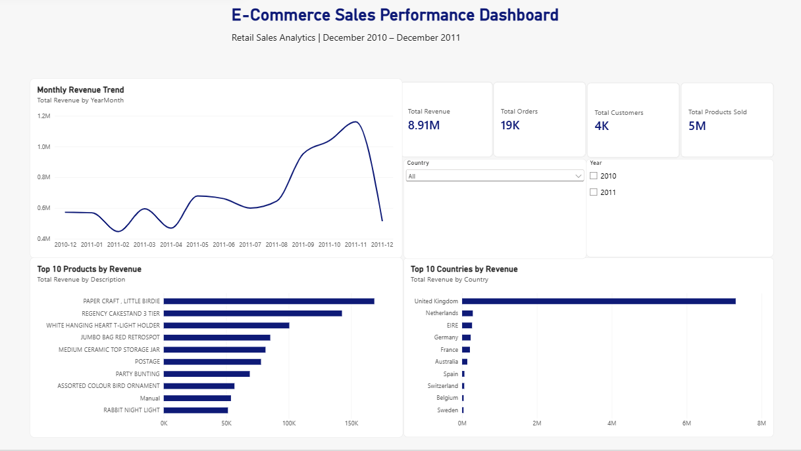

# E-Commerce Sales Performance Dashboard

## Project Overview
An interactive Power BI dashboard analysing e-commerce retail sales performance from December 2010 to December 2011.

## Dashboard Preview

## Key Performance Indicators
- Total Revenue: 8.91M
- Total Orders: 19K
- Total Customers: 4K
- Total Products Sold: 5M

*Figures are rounded and reflect the unfiltered dashboard.*

## Dashboard Features
- Monthly revenue trend analysis
- Top 10 products by revenue
- Top 10 countries by revenue
- Interactive year and country slicers
- Sales performance KPI cards

## Tools and Technologies
- Microsoft Power BI Desktop
- Power Query for data cleaning and transformation
- DAX for calculated measures
- Microsoft Excel as the source dataset

## Data Preparation
- Removed cancelled transactions
- Filtered invalid quantities and unit prices
- Removed records with missing CustomerID
- Created TotalSales using Quantity × UnitPrice
- Added date-related columns for time-based analysis

## Project Files
- `Ecommerce_Sales_Dashboard.pbix` — Power BI report
- `dashboard-preview.png` — Dashboard screenshot

## Skills Demonstrated
Data cleaning, data transformation, KPI reporting, data visualisation, sales analytics, and interactive dashboard development.
